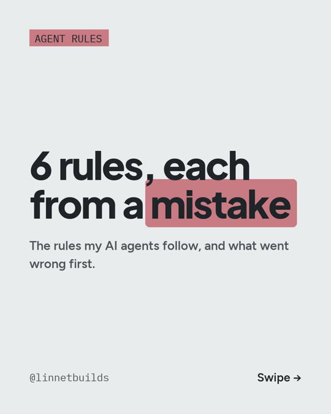

# C01: 6 rules, each from a mistake

**Carousel:** 2026-10-29

The rules my AI agents follow. Each one exists because something went wrong first.

1. **Fetch the record itself.** A summary can omit context or get a number wrong. Before citing a
   number, date or quotation, retrieve the original record. See R03.
2. **Answer first.** No praising the question, no narrating the method.
3. **Confess once.** One clause, then the correct value.
4. **Cut every draft in half.** Drafts that followed every other rule were still too long.
5. **Banned words, checked on write.** A hook scans each file as it is saved.
6. **Unsure means unwritten.** Exact match: written. Fuzzy: waits for me. None: not written.

Ready to paste, in English and Spanish, with the hook for rule 5:
[resources/agent-rules](../resources/agent-rules/).

Cost: the rules and the hook are plain text files, $0. They need an AI coding tool; the
minimum is Claude Pro, $20/month (prices as of Oct 2026).
