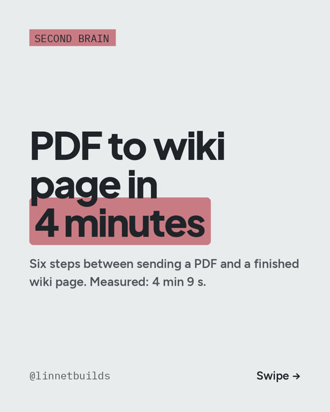

# C02: De PDF a página de wiki en 4 minutos

**Carrusel:** 2026-11-05

Los seis pasos entre mandar un PDF y tener lista la página de la wiki. Medido en la grabación
de R01, el 2026-10-18: **4 min 9 s** del celular a la página.

1. **Mandar** el PDF o el enlace a un bot de Telegram, desde el celular.
2. **Llega a `raw/`** con una nota de dónde salió: enlace, texto del mensaje, fecha. El
   original no se edita nunca.
3. **Un parser lo desarma:** texto, tablas en HTML, ecuaciones en LaTeX, y figuras. Corre
   en mi propia computadora, así que leer el PDF no gasta tokens.
4. **Un agente escribe la página:** la cita, la idea principal en una línea, una frase
   citable y las afirmaciones atadas al paper.
5. **La wiki se pone al día:** el agente actualiza las páginas de conceptos que toca y marca
   las contradicciones. Una contradicción seria detiene la ingesta y me espera a mí.
6. **Avisa de vuelta:** índice, registro y un resumen corto al celular. Un script nocturno,
   sin nada de IA, rearma la bibliografía (ver R06) y el panel.

La IA de pago solo hace los pasos 4 y 5. Todo lo demás son scripts.

El detalle completo, las herramientas, lo que hay que tener en cuenta y un prompt para
probarlo: [R01](R01-paper-to-wiki.md).

Costo (precios a oct 2026): el bot de Telegram, el parser (MinerU) y Obsidian son gratis
(Obsidian para uso personal). El agente necesita Claude Code; lo mínimo es Claude Pro,
**$20/mes**, que tiene límites de uso. Yo uso Max ($200/mes) para todo lo que construyo.

---

**In English:** six steps from sending a PDF to a finished wiki page, measured on the R01
recording: 4 min 9 s. The parser runs locally with no tokens; the paid AI only writes the
page and updates the wiki. Minimum: Claude Pro, $20/month, with usage limits (Oct 2026).
