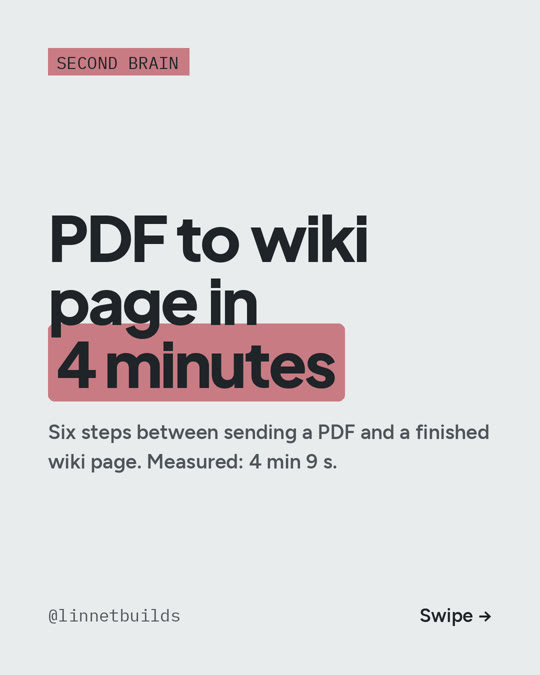

# C02: PDF to wiki page in 4 minutes

**Carousel:** 2026-11-05

The six steps between sending a PDF and a finished wiki page. Measured on the R01 recording
run, 2026-10-18: **4 min 9 s** from the phone to the page.

1. **Send** the PDF or link to a Telegram bot, from the phone.
2. **It lands in `raw/`** with a note on where it came from: link, caption, date. The
   original is never edited.
3. **A parser takes it apart:** text, tables as HTML, equations as LaTeX, and figures. It runs
   on my own computer, so reading the PDF spends no tokens.
4. **An agent writes the page:** citation, one-line takeaway, a quotable sentence, and claims
   tied back to the paper.
5. **The wiki catches up:** the agent updates the concept pages it touches and flags
   contradictions. A hard contradiction stops the ingest and waits for me.
6. **It reports back:** index, log and a short summary to the phone. A nightly script, with no
   AI in it, rebuilds the bibliography (see [R06](R06-bibliography.md)) and the dashboard.

The paid AI only does steps 4 and 5. Everything else is scripts.

The full write-up, the tools, the gotchas and a prompt to try it: [R01](R01-paper-to-wiki.md).

Cost (prices as of Oct 2026): the Telegram bot, the parser (MinerU) and Obsidian are free
(Obsidian for personal use). The agent needs Claude Code; the minimum is Claude Pro,
**$20/month**, which has usage limits. I use Max ($200/month) for everything I build.

---

**En español:** seis pasos entre mandar un PDF y tener la página en la wiki, medidos en la
grabación de R01: 4 min 9 s. El parser corre en mi computadora, sin gastar tokens; la IA de
pago solo escribe la página y actualiza la wiki. Costo mínimo: Claude Pro, $20/mes, con
límites de uso (precios a oct 2026).
