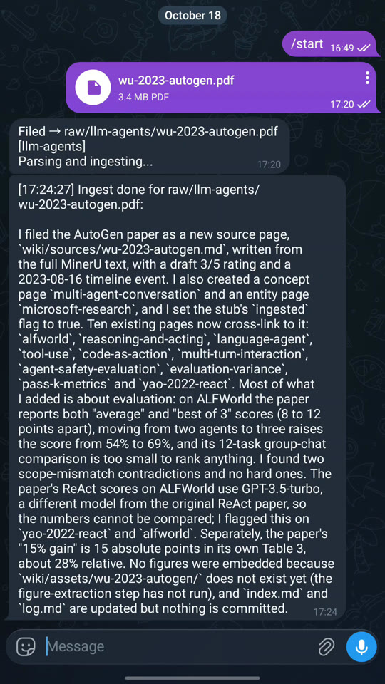

# R01: El parser lee, la IA escribe

**Video:** 2026-10-26 · voz en inglés

Mis papers los lee un parser en mi propia computadora, no la IA que pago. Esa IA solo
escribe la página de la wiki.

## Qué hace

1. **Mandar.** Desde el celular mando un PDF (o un enlace de arXiv) a un bot privado de
   Telegram. Una etiqueta corta en el texto del mensaje, como `#llm-agents`, dice a qué
   parte de la wiki pertenece.
2. **Archivar.** En mi computadora, el bot guarda el PDF en una carpeta de fuentes sin
   procesar, junto a una notita de dónde salió (cuándo, cómo llegó, el texto del mensaje).
   El archivo original no se edita nunca.
3. **Desarmar.** Un parser de PDF saca el texto, las tablas, las ecuaciones y las figuras.
   Se queda con los diagramas y deja fuera logos y fotos.
4. **Escribir.** Un agente de IA lee el paper y escribe su página en la wiki: la cita, la
   idea principal en una línea y las afirmaciones clave, cada una atada al paper. Enlaza la
   página con páginas de conceptos que ya están en la wiki y las actualiza.
5. **Responder.** El bot me manda un resumen corto al celular.

La wiki es una carpeta de archivos Markdown simples, abierta en Obsidian.

## Medido

Grabación del 2026-10-18: PDF mandado desde el celular a las 17:20, ingesta terminada a las
17:24:27, o sea **4 min 9 s** del celular a la página, parser incluido.



El parser encontró 174 bloques de texto, 20 tablas, 1 ecuación y 21 figuras y gráficos en
el paper (Wu et al. 2023, AutoGen, arXiv:2308.08155), y la nueva página quedó enlazada a 12
páginas que ya estaban en la wiki.

El parser corre en mi propia GPU, así que leer el PDF no gasta tokens de IA.

Prueba anterior sin el parser, 2026-10-16: **2 min 40 s**.

## Herramientas

| Pieza | Herramienta |
|---|---|
| Bandeja de entrada en el celular | Un bot de Telegram (Telegram Bot API) |
| Parser de PDF | MinerU (código abierto) |
| Agente | Claude Code, corriendo sin terminal (`claude -p`) |
| Wiki | Archivos Markdown, vistos en Obsidian |

## Costo (precios a oct 2026)

- Bot de Telegram: gratis.
- MinerU y Obsidian: gratis (Obsidian es gratis para uso personal).
- Claude Code: incluido desde Claude Pro, **$20/mes**, que tiene límites de uso. Yo uso Max
  ($200/mes) para todo lo que construyo, no solo para esto.

## En pantalla

Una bóveda de demostración con papers de acceso abierto.

## Pruébalo

Arma una versión local pequeña de los pasos 2 y 4. Un script archiva un PDF en `raw/` junto
a una nota `.source.md` de dónde salió. Luego el agente escribe la página del paper en la
wiki: la cita, la idea principal en una línea y las afirmaciones clave, cada una con su
número de página. Necesita Claude Code (o Codex), Python 3 y `pdftotext` (poppler-utils),
y se corre en una carpeta vacía con un PDF de acceso abierto adentro. Deja fuera la bandeja
de Telegram y el parser MinerU; agrégalos cuando esto funcione. Probado el 2026-10-16 con
Claude Code 2.1.301. Pasó a la primera, en unos 2 minutos, con un paper de arXiv de acceso
abierto, y revisé las páginas citadas contra el PDF.

El prompt va en inglés, que es como lo probé.

```text
Build a tiny "paper inbox -> wiki" in this folder. Needs Python 3; to read PDFs use your own PDF reading or `pdftotext` (poppler-utils). I have put one open-access PDF in this folder.

1. Create `raw/` (filed sources, never edited after filing), `wiki/sources/` and `wiki/concepts/`. Add two short concept pages to `wiki/concepts/`: `multi-agent-systems.md` and `tool-use.md` (title + two lines each).
2. Write `file_paper.py PDF --tag TAG [--note TEXT]` (standard library only): copy (never move) the PDF to `raw/<tag>/`, refuse to overwrite, and write `<file>.source.md` next to it with: filed_at (ISO time), original path, sha256, tag, note.
3. Write `SOURCE_PAGE.md`: instructions an agent follows to turn one filed PDF into `wiki/sources/<file stem>.md` with exactly these sections:
   - `## Citation`: authors, year, title, venue or arXiv id, as printed on the paper
   - `## Takeaway`: one line
   - `## Key claims`: 3-7 bullets, each ending with its PDF page number, like `(p. 4)`
   - `## Concepts`: [[wikilinks]] only to pages that exist in `wiki/concepts/`, and add a backlink line to each linked concept page
   - `## Source`: relative links to the raw PDF and its .source.md
   Rules: use only the PDF (no memory, no web); every claim must be on the page it cites; if unsure, leave it out.
4. File the PDF in this folder with tag `test`, then follow SOURCE_PAGE.md yourself to write its page.

Done when: the sha256 of `raw/test/<file>.pdf` matches the one in its .source.md, the source page has all five sections, every key claim ends with a page number, and every [[link]] has a file in `wiki/concepts/`.
Left out on purpose: the phone inbox (e.g. a Telegram bot) and a full PDF parser for tables, equations and figures (e.g. MinerU).
```

## Ojo con esto

- **MinerU 3.4 etiqueta los gráficos como `chart`, no como `image`.** Un puente que solo
  copia bloques `image` bota todos los gráficos sin avisar.
- **`pdftext` 0.7.1 hizo caer a MinerU 3.4.0** con un paper. Fijar `pdftext` por debajo
  de 0.7 lo arregló.
- **Sin Pillow, el filtro de tamaño para logos y fotos veía todas las imágenes como 0x0**,
  así que no se saltaba ninguna.
- **Un filtro de tamaño y forma para detectar "¿es una foto de carnet?" atrapó solo 5 de 13
  fotos de autores** en un paper, porque los retratos más altos pasan por figuras. Nunca
  confíes en él sin revisar.
- **Cámbiale el nombre al PDF antes de archivarlo** (por ejemplo `author-year-topic.pdf`).
  La página se llama como el archivo, así que dos archivos llamados `paper.pdf` chocarían.
  (Lo encontré al probar el prompt.)
- **"(p. 4)" significa la 4.ª página del PDF.** En una separata de revista, puede no ser el
  número impreso en la página. (Lo encontré al probar el prompt.)

---

**In English:** I send a paper to a Telegram bot; a parser on my own computer reads it with
no AI tokens, and an agent writes the wiki page with each claim tied to its page. Measured:
4 min 9 s. Minimum cost: Claude Pro, $20/month, with usage limits (prices as of Oct 2026).
