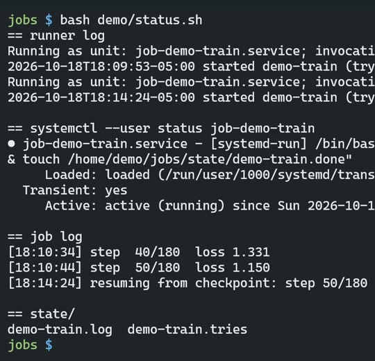

# R02: A file that exists, but empty

**Video:** 2026-10-28 · Spanish voice

A power cut can leave you a file that exists, but is empty. It happened to me. This is what I
do now.

## What it does

When the power goes, the computer restarts and long jobs die. This brings them back on their
own:

1. **A small file per job**, two lines: where it runs and what command it runs.

   ```
   WORKDIR=/home/demo/jobs/train
   CMD=python3 train.py
   ```

2. **A script** starts every unfinished job as a system service (systemd), retries it up to
   **6 times** and, when it finishes cleanly, leaves a done marker (`state/<name>.done`).
3. **Cron** runs that script when the machine boots (2 minutes after startup) and **every 30
   minutes**.
4. **The job saves its progress**, so it comes back from where it stopped, not from zero.
5. **Atomic writes:** results go to a temporary file, are forced to disk (fsync) and only then
   renamed. A cut halfway leaves the previous file complete, never an empty one.

## Measured

Demo recording, 2026-10-18:

- **Power cut:** switched off at step 50 of 180 (18:10:44). The script started the job again
  and at 18:14:24 it continued from step 50, with nobody touching anything.
- **Atomic writes:** a script that cuts a write in half. Without atomic writes, `results.json`
  ended up at **0 bytes**. With them, the previous file stayed whole (56 bytes).



## Tools and cost (prices as of Oct 2026)

Linux, systemd, cron and Python. **$0**: it all comes with the system.

The code goes public on this GitHub in December, as `resume-runner`.

## Try it

Paste this prompt into Claude Code or Codex, in an empty folder.

It builds a small version of the runner:
- two-line `.job` files;
- a script that starts every unfinished job as a systemd user service, with up to 6 tries and
  the `state/<name>.done` marker;
- an example job that counts to 30 and saves its progress with atomic writes;
- the two cron lines (at boot + 2 min, and every 30 min). The agent shows them to you and
  **does not install them without asking**.

Needs Linux with systemd and cron (WSL2 with systemd enabled works) and Python 3. It leaves out
notifications, job dependencies and queues. Tested 2026-10-16 with Claude Code 2.1.301: it
passed on the first run, in under 2 minutes. In the test I asked it not to install anything. I
tested the runner myself separately, with throwaway jobs:
- it started the job and didn't start a second copy;
- after I stopped it at step 7, it continued from step 7;
- it left the done marker;
- a job that always fails gave up after 6 tries.

```text
Build a small "resume runner" in this folder so long jobs come back after a reboot or power cut. Needs Linux with systemd user services and cron (WSL2 with systemd enabled works) and Python 3, standard library only. Use absolute paths everywhere, since cron does not start in this folder.

1. Jobs are `jobs/<name>.job` files with two lines: `WORKDIR=/abs/path` and `CMD=command to run`.
2. `runner.py`: for each job without `state/<name>.done`:
   - skip it if its systemd user unit `<prefix><name>.service` is active (prefix from env `RR_PREFIX`, default `rr-`);
   - if `state/<name>.tries` already says 6, log that it gave up and skip it;
   - otherwise add one try and start it with `systemd-run --user` (unit `<prefix><name>`, its WORKDIR, auto-cleanup of finished units) wrapped so exit code 0 creates `state/<name>.done`.
   Log one line per action, with a timestamp, to `state/runner.log`.
3. `atomic_write.py` with `atomic_write(path, text)`: temp file in the same folder, flush, os.fsync, os.replace onto the target, then fsync the folder.
4. Example job `jobs/count.job` running `example/count.py`: counts to 30, one step per second, saves its step with atomic_write after each step, and resumes from the saved step when restarted.
5. Cron: show me the two crontab lines, `@reboot sleep 120 && /usr/bin/python3 <abs>/runner.py` and `*/30 * * * * /usr/bin/python3 <abs>/runner.py`, then ASK before installing them. Install nothing in crontab without my yes.

Done when: `python3 runner.py` starts the count job (`systemctl --user status rr-count` shows it running); running it again does not start a second copy; after `systemctl --user stop rr-count`, running it again resumes from the saved step, not from 0; and `state/count.done` appears when it finishes.
Left out on purpose: notifications, job dependencies, queues.
```

## Gotchas

- **A power cut left a results file that existed but was empty.** That's why the atomic writes:
  temporary file, fsync, rename.
- **The script waits 120 s after boot, on purpose.** If you record it, cut the wait in the
  video; don't shorten it in the crontab.
- **If you run it in WSL, closing every WSL window shuts it down**, just like a power cut.
- **systemd user services only run while you are logged in**, unless you turn on
  `loginctl enable-linger <user>`. Without it, after a restart nothing starts until you log in.
  (Claude Code pointed this out in the test.)
- **Every restart uses up a try**, including a `systemctl --user stop` or a blackout. A job cut
  6 times gives up even if it never failed. To start the count again, delete
  `state/<name>.tries`. (Seen in the test.)

---

**En español:** cada trabajo largo es un archivo de dos líneas. Un script lo arranca como
servicio de systemd, lo reintenta hasta 6 veces y deja una marca de listo; cron corre el script
al prender y cada 30 minutos; los resultados se escriben de forma atómica. En un corte real, el
trabajo siguió en el paso 50 de 180 sin que nadie tocara nada. Costo: $0. La versión completa
en español está en el botón ES.
