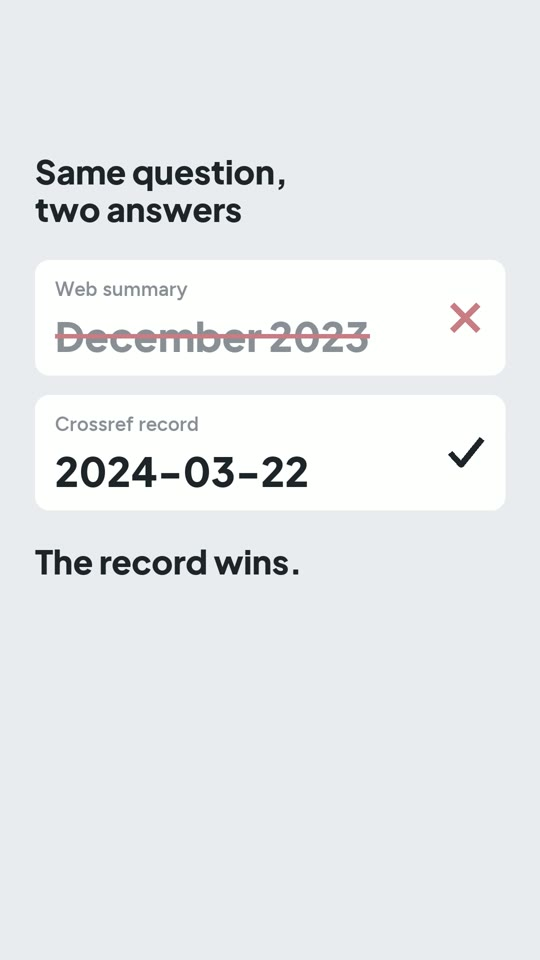

# R03: Claude Code can receive a summary instead of the page

**Video:** 2026-10-30 · English voice

## The problem

When Claude Code uses WebFetch to read a webpage, it usually receives the output
of a separate AI extraction step, rather than the full page. That output may be
a summary or an answer to the extraction prompt. The prompt affects what the
agent receives. This hidden step is the discovery the video explains first.

The video then uses a labelled wrong-date reenactment to show why I fetch the
original publication record before citing a date. Other tools can return fuller
content; this describes WebFetch, not every AI browser.

Documentation checked 2026-10-26: https://code.claude.com/docs/en/tools-reference#webfetch-tool-behavior

## The rule

No number, date, identifier, quotation or status in my notes may come from a summary.

- A summary may tell the agent **which** pages are worth reading.
- For anything that matters, the agent fetches the record itself and saves it. For a
  paper, that is its Crossref entry (or OpenAlex), read directly, for example:

  ```
  curl -s https://api.crossref.org/works/10.1007/s11704-024-40231-1
  ```

- Notes cite the saved record, never the summary.

## On screen

The video uses a **reenactment**, labelled as such: a summary that
gives the paper's publication date as December 2023. The comparison then uses the real Crossref
record for the same DOI, which says **2024-03-22**.



## Cost (prices as of Oct 2026)

- Crossref API: free, no key.
- Claude Code: included from Claude Pro, **$20/month**, which has usage limits. I use Max ($200/month).

## Try it

The prompt writes the rule into `CLAUDE.md`, with the same text in `AGENTS.md` for Codex. It
also writes `fetch_record.py`, a small script that:
- fetches a paper's Crossref record by DOI;
- saves the record in `records/` without its reference list;
- prints the publication date.

Needs Claude Code (or Codex), Python 3 and internet; no API key. It leaves out OpenAlex, arXiv
and non-paper records. Tested on 2026-10-16 with Claude Code 2.1.301. It passed on the first
run in 34 s. The DOI from the video printed 2024-03-22, and the saved record had no reference
list.

```text
Set up a "no numbers from summaries" rule and a record fetcher in this folder. Needs Python 3 and internet.

1. Create `CLAUDE.md` and `AGENTS.md` (same text, so Claude Code and Codex both read it) containing exactly this rule:

   ## Records, not summaries
   - No number, date, identifier (DOI, ISBN, ID), quotation or status (published, retracted, accepted) in these notes may come from a web search result or a page summary.
   - A summary may only decide which sources are worth reading.
   - For anything that matters, fetch the record itself, save it under `records/`, and cite the saved file.
   - For a paper, the record is its Crossref entry: run `python3 fetch_record.py <DOI>`.

2. Write `fetch_record.py DOI` (standard library only): GET `https://api.crossref.org/works/<DOI>` with a User-Agent that includes `mailto:you@example.org`; save the `message` object as `records/<DOI with / replaced by _>.json`, without its `reference` list (it is full of other people's names); print the DOI, the title, and the `published` date as YYYY-MM-DD (or YYYY-MM / YYYY if that is all the record has). Exit with a clear message on a 404 or network error.

Done when: `python3 fetch_record.py 10.1007/s11704-024-40231-1` prints the date 2024-03-22, the saved JSON has no `reference` key, and both CLAUDE.md and AGENTS.md contain the rule.
Left out on purpose: OpenAlex, arXiv and non-paper records; add a fetcher per source the same way.
```

## Gotchas

- **The summary sounds equally confident whether or not the number was on the page.** Its
  tone tells you nothing; only the record does.
- **One paper can have several dates.** This DOI's Crossref record says published online
  2024-03-22 and published in print 2024-12 (volume 18, issue 6). Name the field you mean. The
  prompt uses `published`, which here is the online date. (Found while testing the prompt.)
- **A Crossref record includes the paper's full reference list**, with other people's names.
  If names matter in your notes, keep it out of the saved record, as the prompt does.

---

**En español:** antes de citar una fecha o un número que aparece en un resumen, reviso la fuente: el agente busca el
registro real (para un paper, Crossref), lo guarda y cita desde ahí. Costo mínimo: Claude
Pro, $20/mes, con límites de uso (precios a oct 2026).

**Pruébalo:** el prompt de "Try it" (en inglés) escribe la regla en `CLAUDE.md` /
`AGENTS.md` y un script que baja el registro de Crossref por DOI. Probado el 2026-10-16: para
este paper imprime 2024-03-22.
