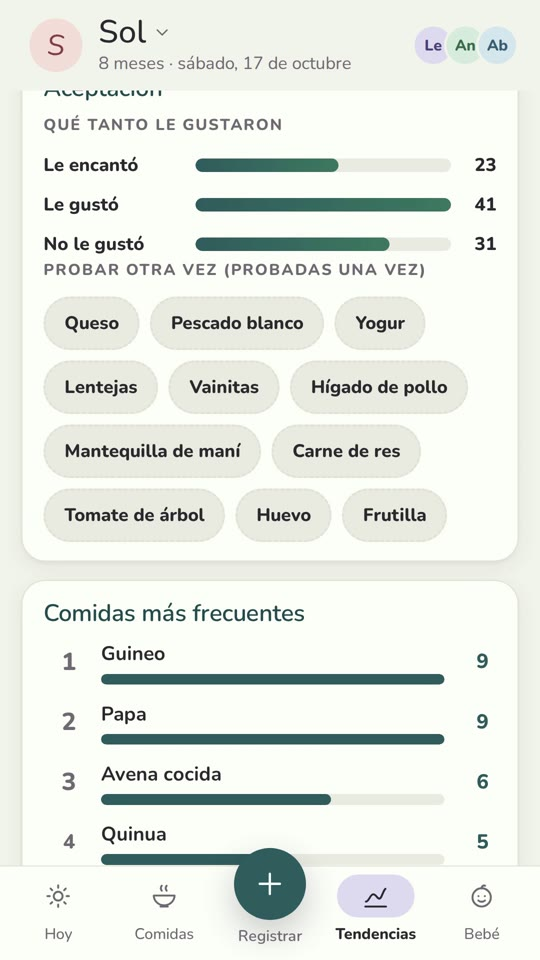

# R04: La app gratis no me decía nada

**Video:** 2026-11-02 · voz en inglés

## Por qué la hice

Cuando mi peque empezó con la comida sólida, la app gratis que usaba registraba las comidas. Y
nada más. Yo quería saber qué había probado ya mi peque, cuántas veces y qué no salió bien. Así
que hice la mía. La usamos todos los días durante seis meses; el video muestra una versión
rehecha con datos de demo.

## La idea central: un solo registro, cada quien en su idioma

Todos en la casa anotan en el mismo lugar. Cada comida se guarda en inglés y en español, y cada
celular elige su idioma. La abuelita anota "zapallo"; en mi celular sale "pumpkin". Nadie
traduce nada a mano.

Como todas las comidas caen en un solo registro, los conteos salen solos: guineo, nueve veces.
Lenteja, una vez. No hubo segunda vez.

## Qué más hace

- **Cada comida** guarda la porción, la textura y, si hubo reacción, los síntomas, qué tan
  fuerte, cuándo empezó y qué se hizo.
- **La lista de alimentos** usa nombres locales de Ecuador (zapallo, guineo, naranjilla, tomate
  de árbol) y marca los alérgenos.
- **Varias personas que cuidan** leen y escriben el mismo registro.
- **Funciona sin internet** y se sincroniza cuando vuelve la conexión.
- **Resumen para el pediatra:** crecimiento, los últimos 7 días y las reacciones, en el idioma
  del celular.

## En pantalla



## Estado

Todavía no está publicada: ni enlace ni precio.

## Costo de hacer algo parecido (precios a oct 2026)

La hice con Claude Code en el plan Max, **$200/mes**, que ya pago para todo lo que construyo.
Claude Pro (**$20/mes**) también incluye Claude Code, con límites de uso: una app de este tamaño
avanza más lento en Pro, con pausas cuando llegas al límite.

El resto no cuesta nada, porque solo mi familia usa la app:

| Pieza | Para qué | Costo |
|---|---|---|
| Ubuntu | donde trabajo | gratis |
| Supabase | base de datos e inicio de sesión | plan gratis (límites abajo) |
| Cloudflare Workers | sirve la app y manda notificaciones | plan gratis (límites abajo) |
| **Extra al mes** | | **$0** |

Límites del plan gratis, revisados el 20 de octubre de 2026 (cambian; revísalos antes de
empezar):
- **Supabase:** 2 proyectos activos por cuenta, base de datos de 500 MB, 1 GB de almacenamiento
  de archivos, 50,000 usuarios activos al mes y 5 GB de tráfico de salida. Un proyecto se pausa
  después de 7 días sin actividad.
- **Cloudflare Workers:** 100,000 solicitudes al día y 5 tareas programadas (cron) por cuenta.
  Pasadas las 100,000 en un día, la app devuelve el error 1027 hasta el día siguiente.

Una familia usa una fracción mínima de esto.

## Pruébalo

Pega este prompt en Claude Code o Codex, en una carpeta vacía. Arma una versión chiquita de la
idea central: una sola página, sin servidor.
- Cada alimento tiene un nombre en inglés y otro en español.
- Cada dispositivo elige su idioma.
- Los registros se guardan en IndexedDB.
- Funciona sin internet después de la primera carga.

Necesitas Python 3 (para servirla) y un navegador moderno. Deja fuera la sincronización, las
varias personas que cuidan, las reacciones y los alérgenos, y el resumen para el pediatra.
Probado el 2026-10-16 con Claude Code 2.1.301: pasó a la primera, en 52 s, con unas 220 líneas.
Lo revisé con Playwright:
1. agregué un alimento propio y un registro;
2. cambié a español, y el registro pasó a "Zapallo";
3. me desconecté y recargué: el registro seguía ahí, en español.

El prompt va en inglés, que es como lo probé.

```text
Build a tiny offline-first bilingual food log in this folder: a single-page web app (`index.html`, `app.js`, `sw.js`, `manifest.json`), plain JavaScript, no framework, no build step, no backend. Needs Python 3 (to serve it) and a modern browser.

- A built-in list of 10 foods, each with an English and a Spanish name (e.g. pumpkin / zapallo, banana / guineo, avocado / aguacate), plus "add food" that asks for both names.
- Log an entry: food, date and time, amount (a little / half / all), optional note. Store the food id and both names with the entry, never just the displayed text.
- A language toggle (English / Español) per device, remembered in localStorage. Switching changes every label and every food name on screen, including entries already logged; stored data does not change.
- Entries saved in IndexedDB, listed newest first, each with a delete button.
- A service worker caches the app shell so the app loads offline after the first visit.
- Give buttons, inputs and list items `data-testid` attributes.
Keep it small: under 300 lines in total.

Done when: served with `python3 -m http.server 8000`, you can log an entry, switch to Español and see the food's Spanish name, then go offline (browser DevTools > Network > Offline), reload, and the entry is still there.
Left out on purpose: sync between devices, several caregivers, reactions and allergens, a doctor summary.
```

## Ojo con esto

- **Sin internet, un registro guardado tardó unos 7 s en aparecer, no al instante.** La app
  seguía intentando recargar el diario sin conexión. Solución: no recargar mientras
  `navigator.onLine` sea false.
- **En Ecuador, la "merienda" es la comida de la noche.** Por eso los nombres de las comidas no
  se traducen palabra por palabra entre idiomas.
- **Ábrela una vez con internet antes de probarla sin conexión.** El service worker guarda los
  archivos en esa primera visita.
- **Supabase pausa los proyectos gratis después de 7 días sin actividad.** El uso diario lo
  mantiene despierto; si lo dejas una semana para probar después, lo vas a encontrar dormido y
  tendrás que restaurarlo desde el panel de Supabase.
- **Claude Code escribió la app pero no la abrió en un navegador**: no tenía permiso para
  arrancar el servidor, y lo dijo. La prueba del "done when" te toca a ti. (Visto en la prueba.)

---

**In English:** an app to log my kid's meals, in English and Ecuadorian Spanish, where the whole
house writes to one log and each phone reads it in its own language. Not released yet. Extra
cost beyond Claude Max: $0 (Supabase and Cloudflare Workers free plans, limits checked Oct 20,
2026); the prompt above builds a one-page, serverless version.
