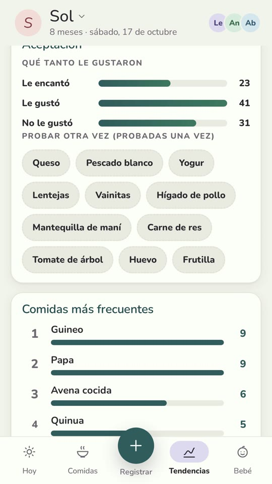

# R04: The free app told me nothing

**Video:** 2026-11-02 · English voice

## Why I built it

When my kid started solids, the free app I used logged meals. And nothing else. I wanted to
know what my kid had already tried, how many times, and what didn't go well. So I built my
own. We used it every day for six months; the video shows a rebuilt version with demo data.

## The one idea: one log, each person in their own language

Everyone in the house logs in the same place. Each meal is stored in English and in Spanish,
and each phone picks its language. Grandma logs "zapallo"; my phone shows "pumpkin". Nobody
translates anything by hand.

Because every meal lands in one log, the counts come for free: banana, nine times. Lentils,
once. There was no second time.

## What else it does

- **Each meal** records portion, texture and, if there was a reaction, the symptoms, how
  strong, when it started and what was done.
- **The food list** uses local Ecuadorian names (zapallo, guineo, naranjilla, tomate de árbol)
  and flags allergens.
- **Several caregivers** read and write the same log.
- **Works offline** and syncs when the connection comes back.
- **Summary for the pediatrician:** growth, the last 7 days and reactions, in the phone's
  language.

## On screen



## Status

Not released yet: no link, no price.

## Cost to build something like it (prices as of Oct 2026)

I built it with Claude Code on the Max plan, **$200/month**, which I already pay for
everything I build. Claude Pro (**$20/month**) also includes Claude Code, with usage limits:
an app this size moves slower on Pro, with pauses when you hit the limit.

The rest of the setup costs nothing, because only my family uses the app:

| Piece | What for | Cost |
|---|---|---|
| Ubuntu | where I work | free |
| Supabase | database and sign-in | free plan (limits below) |
| Cloudflare Workers | serves the app and sends notifications | free plan (limits below) |
| **Extra per month** | | **$0** |

Free plan limits, checked October 20, 2026 (they change; check them before you start):
- **Supabase:** 2 active projects per account, 500 MB database, 1 GB file storage, 50,000
  monthly active users and 5 GB egress. A project pauses after 7 days without activity.
- **Cloudflare Workers:** 100,000 requests a day and 5 scheduled tasks (cron) per account.
  Past 100,000 in a day, the app returns error 1027 until the next day.

One family uses a tiny fraction of this.

## Try it

Paste this prompt into Claude Code or Codex, in an empty folder. It builds a tiny version of
the one idea: a single page, no server.
- Each food has an English and a Spanish name.
- Each device picks its language.
- Entries are saved in IndexedDB.
- It works offline after the first load.

Needs Python 3 (to serve it) and a modern browser. It leaves out sync, several caregivers,
reactions and allergens, and the pediatrician summary. Tested 2026-10-16 with Claude Code
2.1.301: it passed on the first run, in 52 s, with about 220 lines. I checked it with
Playwright:
1. added a custom food and an entry;
2. switched to Spanish, and the entry changed to "Zapallo";
3. went offline and reloaded: the entry was still there, in Spanish.

```text
Build a tiny offline-first bilingual food log in this folder: a single-page web app (`index.html`, `app.js`, `sw.js`, `manifest.json`), plain JavaScript, no framework, no build step, no backend. Needs Python 3 (to serve it) and a modern browser.

- A built-in list of 10 foods, each with an English and a Spanish name (e.g. pumpkin / zapallo, banana / guineo, avocado / aguacate), plus "add food" that asks for both names.
- Log an entry: food, date and time, amount (a little / half / all), optional note. Store the food id and both names with the entry, never just the displayed text.
- A language toggle (English / Español) per device, remembered in localStorage. Switching changes every label and every food name on screen, including entries already logged; stored data does not change.
- Entries saved in IndexedDB, listed newest first, each with a delete button.
- A service worker caches the app shell so the app loads offline after the first visit.
- Give buttons, inputs and list items `data-testid` attributes.
Keep it small: under 300 lines in total.

Done when: served with `python3 -m http.server 8000`, you can log an entry, switch to Español and see the food's Spanish name, then go offline (browser DevTools > Network > Offline), reload, and the entry is still there.
Left out on purpose: sync between devices, several caregivers, reactions and allergens, a doctor summary.
```

## Gotchas

- **Offline, a saved entry took about 7 s to appear, not instantly.** The app kept retrying to
  reload the diary with no connection. Fix: don't reload while `navigator.onLine` is false.
- **In Ecuador, "merienda" is the evening meal.** That's why meal names aren't translated
  word for word between languages.
- **Open it once online before testing it offline.** The service worker caches the files on
  that first visit.
- **Supabase pauses free projects after 7 days without activity.** Daily use keeps it awake;
  if you leave it for a week to test later, you'll find it asleep and have to restore it from
  the Supabase dashboard.
- **Claude Code wrote the app but didn't open it in a browser**: it had no permission to start
  the server, and it said so. The "done when" check is on you. (Seen in the test.)

---

**En español:** una app para registrar la comida de mi peque, en inglés y en español de
Ecuador. Toda la casa anota en el mismo registro y cada celular lo lee en su idioma: la
abuelita anota "zapallo" y en mi celular sale "pumpkin". Guarda porciones y reacciones, usa
nombres locales, funciona sin internet y arma un resumen para el pediatra. Todavía no está
publicada. Costo aparte de Claude Max: $0 (Supabase y Cloudflare Workers en plan gratis,
límites revisados el 20 oct 2026). El prompt de arriba arma una versión mínima: una página,
sin servidor, con el idioma elegido en cada dispositivo.
