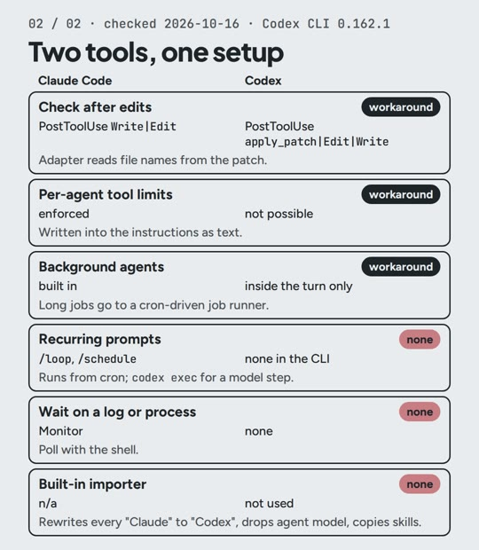

# R05: Dos herramientas de IA, reglas escritas una vez

**Video:** 2026-11-13 · voz en inglés

Cambiar de herramienta de IA para programar suele significar volver a escribir tus reglas. Yo
uso Claude Code y Codex sobre una misma configuración; si una se cae, abro la otra y sigo
trabajando. Esta nota tiene los tres pasos del video, el prompt y los archivos listos para
copiar.

## Los tres pasos

1. **Un solo archivo de reglas** (`rules/RULES.md`). Es el único archivo que edito. Copiar
   reglas a mano funciona exactamente una vez.
2. **Un script lo escribe dos veces:** `CLAUDE.md` para Claude Code y `AGENTS.md` para Codex,
   cada uno con una línea que dice dónde editar. `--check` falla cuando alguno quedó
   desactualizado, así que una edición a mano no pasa piola.
3. **Cada sesión termina con un archivo de traspaso** (`HANDOFF.md`): estado actual, decisiones,
   próximos pasos. La herramienta que se abra después lo lee primero, así sabe dónde se quedó la
   anterior.

## Costo (precios a oct 2026)

- Los archivos y el script: $0.
- Claude Code: incluido desde Claude Pro, **$20/mes**, que tiene límites de uso. Yo uso Max
  ($200/mes) para todo lo que construyo, no solo para esto.
- Codex: lo uso con ChatGPT Plus, **$20/mes** (página de precios de OpenAI, revisada el
  2026-10-20).

## Pruébalo

Pega esto en tu herramienta de IA para programar, en la carpeta de tu proyecto. Necesitas
Python 3.

Probado el 2026-10-29 con Claude Code en una carpeta vacía con un `rules/RULES.md` de dos
líneas: escribió los dos archivos con las mismas reglas; `--check` pasó; después de que agregué
una regla, `--check` marcó los dos archivos como desactualizados y salió con 1.

El prompt va en inglés, que es como lo probé.

```text
Write a Python script, generate.py, standard library only. It reads rules/RULES.md and writes two files with the same rules: CLAUDE.md for Claude Code and AGENTS.md for Codex.

Start each file with a line saying it is generated by generate.py and that edits go in rules/RULES.md, then a heading naming the tool, then the rules. Print one line per file: updated or unchanged.

Add a --check flag that writes nothing, lists the files that are out of date, and exits 1 if any are.
```

Y al final de cada sesión, dile a la herramienta:

```text
Before we stop, write HANDOFF.md: current state, decisions, next steps. Read it first at the start of the next session.
```

La configuración completa que uso, lista para copiar: [resources/two-tools-setup](../resources/two-tools-setup/).
También enlaza las dos carpetas de skills (`.claude/skills` y `.agents/skills`) a una sola
carpeta `skills/`, así que una skill editada para una herramienta queda editada para las dos.
En Windows, córrelo en WSL (o activa el Modo de desarrollador) para que se puedan crear los
enlaces. Probado el 2026-10-20 en una carpeta vacía.

## Más: lo que no tiene equivalente

Revisé mi configuración pieza por pieza y le di a cada una un estado: **directo**,
**convertido**, **rodeo** o **ninguno**. De las 12 piezas del mapa corto, 3 no tienen
equivalente en Codex (revisado el 2026-10-16 con Codex CLI 0.162.1):
- **Prompts recurrentes** (`/loop`, `/schedule` en Claude Code). En su lugar corren desde cron;
  un paso que necesita el modelo llama a `codex exec`.
- **Esperar un log o un proceso.** En su lugar, la terminal consulta cada cierto tiempo.
- **El importador incorporado.** No lo uso: cambia cada "Claude" del texto por "Codex".



## Ojo con esto

- **Codex leyó solo los primeros 32 KiB de un archivo de proyecto de 51 KB.** Poner
  `project_doc_max_bytes = 131072` en `~/.codex/config.toml` lo arregló.
- **Codex puede leer `CLAUDE.md` directamente** con
  `project_doc_fallback_filenames = ["CLAUDE.md"]`. Si el proyecto también tiene un
  `AGENTS.md`, ese gana y `CLAUDE.md` se ignora.
- **Un hook de Codex solo corre después de que lo apruebas una vez en `/hooks`.** Hasta
  entonces no hace nada, calladito.
- **Codex no puede limitar las herramientas de un agente.** Los agentes heredan el sandbox del
  padre, así que el límite ("solo lectura, sin terminal") se escribe como texto en las
  instrucciones.

---

**In English:** I use Claude Code and Codex with one rules file: rules live in `rules/RULES.md`,
a script writes `CLAUDE.md` and `AGENTS.md` from it (`--check` flags stale copies), and every
session ends with `HANDOFF.md`. Prompt tested 2026-10-29. Cost: Claude Code from Claude Pro,
$20/month (I use Max, $200/month); Codex with ChatGPT Plus, $20/month (prices as of Oct 2026).
