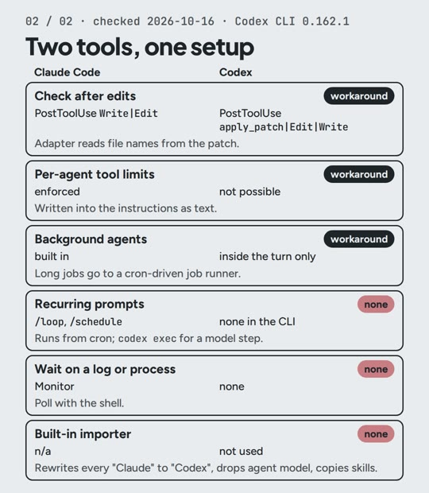

# R05: Two AI tools, rules written once

**Video:** 2026-11-13 · English voice

Switching AI coding tools usually means writing your rules again. I use Claude Code and Codex
on one setup; if one goes down, I open the other and keep working. This note is the three
steps from the video, the prompt, and the files ready to copy.

## The three steps

1. **One rules file** (`rules/RULES.md`). It is the only file I edit. Copying rules by hand
   works exactly once.
2. **A script writes it twice:** `CLAUDE.md` for Claude Code, `AGENTS.md` for Codex, each with
   a line saying where to edit. `--check` fails when one of them is out of date, so a hand edit
   gets caught.
3. **Every session ends with a handoff file** (`HANDOFF.md`): current state, decisions, next
   steps. Whichever tool opens next reads it first, so it knows where the last one stopped.

## Cost (prices as of Oct 2026)

- The files and the script: $0.
- Claude Code: included from Claude Pro, **$20/month**, which has usage limits. I use Max
  ($200/month) for everything I build, not just this.
- Codex: I use it through ChatGPT Plus, **$20/month** (OpenAI's pricing page, checked
  2026-10-20).

## Try it

Paste this into your AI coding tool, in your project folder. Needs Python 3.

Tested 2026-10-29 with Claude Code in an empty folder with a two-line `rules/RULES.md`: it wrote
both files with the same rules; `--check` passed; after I added a rule, `--check` listed both
files as out of date and exited 1.

```text
Write a Python script, generate.py, standard library only. It reads rules/RULES.md and writes two files with the same rules: CLAUDE.md for Claude Code and AGENTS.md for Codex.

Start each file with a line saying it is generated by generate.py and that edits go in rules/RULES.md, then a heading naming the tool, then the rules. Print one line per file: updated or unchanged.

Add a --check flag that writes nothing, lists the files that are out of date, and exits 1 if any are.
```

And at the end of every session, tell the tool:

```text
Before we stop, write HANDOFF.md: current state, decisions, next steps. Read it first at the start of the next session.
```

The full setup I use, ready to copy: [resources/two-tools-setup](../resources/two-tools-setup/).
It also links both skill folders (`.claude/skills` and `.agents/skills`) to one `skills/`
folder, so a skill edited for one tool is edited for both. On Windows, run it in WSL (or turn
on Developer Mode) so the links can be created. Tested on 2026-10-20 in an empty folder.

## More: what has no equivalent

I went through my setup piece by piece and gave each one a status: **direct**, **converted**,
**workaround** or **none**. Of the 12 pieces in the short map, 3 have no Codex equivalent
(checked 2026-10-16 with Codex CLI 0.162.1):
- **Recurring prompts** (`/loop`, `/schedule` in Claude Code). They run from cron instead; a
  step that needs the model calls `codex exec`.
- **Waiting on a log or a process.** The shell polls instead.
- **The built-in importer.** Not used: it rewrites every "Claude" in the text to "Codex".



## Gotchas

- **Codex read only the first 32 KiB of a 51 KB project file.** Setting
  `project_doc_max_bytes = 131072` in `~/.codex/config.toml` fixed it.
- **Codex can read `CLAUDE.md` directly** with
  `project_doc_fallback_filenames = ["CLAUDE.md"]`. If the project also has an `AGENTS.md`,
  that one wins and `CLAUDE.md` is ignored.
- **A Codex hook runs only after you trust it once in `/hooks`.** Until then it does nothing,
  quietly.
- **Codex cannot limit an agent's tools.** Agents inherit the parent's sandbox, so the limit
  ("read-only, no shell") is written into the instructions as text.

---

**En español:** uso Claude Code y Codex con un solo archivo de reglas. Tres pasos: las reglas
viven en `rules/RULES.md`, un script escribe `CLAUDE.md` y `AGENTS.md` desde ahí (y `--check`
avisa si alguno quedó desactualizado), y cada sesión termina con `HANDOFF.md`, para que la
siguiente herramienta sepa dónde quedamos. El prompt de arriba (en inglés) está probado el
2026-10-29. Costo: Claude Code desde Claude Pro, $20/mes, con límites (uso Max, $200/mes);
Codex con ChatGPT Plus, $20/mes (precios a oct 2026).
