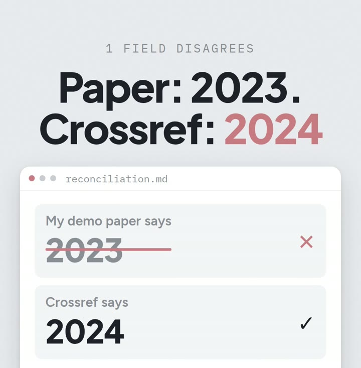

# R06: Atrapa el año equivocado en tus referencias

**Video:** 2026-11-06 · voz en inglés

Un año equivocado en la lista de referencias se pasa fácil, y a los revisores les encanta
encontrarlo. Esta nota tiene los tres pasos del video, más el prompt exacto, probado.

## Los tres pasos

1. **Exporta tus referencias como archivo BibTeX** (`references.bib`), con el DOI de cada paper,
   su identificador permanente. Zotero, Mendeley y casi todos los gestores de referencias pueden
   exportarlo.
2. **Pídele a tu IA un script** que compare cada DOI con Crossref, la base de datos gratis de
   publicaciones. El prompt está abajo.
3. **Córrelo antes de enviar.** Escribe una tabla con cada campo donde tu entrada y el registro
   no coinciden.

## Medido

El `references.bib` de mi paper de demo cita una revisión con año **2023**. Su registro en
Crossref dice **2024**. Ese lo planté yo: la revisión fue un preprint de arXiv en 2023 y un
artículo de revista en 2024. El script lo encontró en 1.3 s, y listó el único DOI que Crossref
no conoce (un DOI de arXiv, ver Ojo con esto).



## Costo (precios a oct 2026)

- API de Crossref: gratis, sin registro, sin clave. Permite 5 solicitudes por segundo, una a la
  vez, o 10 por segundo y 3 a la vez cuando tus solicitudes llevan un correo electrónico
  (documentación de Crossref y encabezados de respuesta, revisados el 2026-10-20). Una lista de
  unos cientos de referencias queda muy dentro de eso.
- El script corre en tu computadora, solo con Python estándar: $0.
- Cualquier IA que escriba código puede escribirlo a partir del prompt. Yo usé Claude Code
  (Claude Max, $200/mes, que ya pago para todo lo que construyo).

## Pruébalo

Pega esto en tu IA (Claude, ChatGPT, Codex, Claude Code), en la carpeta donde está tu
`references.bib`. Necesitas Python 3 e internet; no hace falta clave de API.

Probado el 2026-10-29 con Claude Code sobre el `references.bib` de demo. La primera versión se
detuvo con un 404 en un DOI de arXiv, así que ahora el prompt dice qué hacer con esos. Segunda
corrida: 1 diferencia (año 2023 vs 2024), 1 DOI que no está en Crossref, 1.3 s.

El prompt va en inglés, que es como lo probé.

```text
Write a Python script, check_bib.py, that reads my file references.bib. Use only the Python standard library.

For every entry with a doi field, fetch its record from https://api.crossref.org/works/ followed by the DOI (send a User-Agent header that includes mailto: and my email), and compare title, year, journal, volume and pages with my entry. Ignore differences in capitalization and punctuation. For the year, use the record's print date, then its online date.

Write a table to mismatches.md with: citation key, field, my value, Crossref value. Below the table, list the entries without a DOI, and the DOIs Crossref doesn't know (it answers 404; arXiv DOIs are registered at DataCite, not Crossref) instead of stopping.

Do not change references.bib. Print one line: how many mismatches, how many without DOI, how many not in Crossref.
```

Listo cuando: `python3 check_bib.py` imprime esa línea, `mismatches.md` tiene una fila por cada
campo que no coincide, y `references.bib` sigue igual.

## Ojo con esto

- **No todo DOI es de Crossref.** Los DOI de arXiv (`10.48550/...`) son de DataCite, así que la
  API de Crossref devuelve 404 para ellos. (Visto en la prueba.) Si también necesitas esos,
  pídele al script que pruebe `https://doi.org/<doi>` con
  `Accept: application/vnd.citationstyles.csl+json`.
- **El año del paper y el del registro pueden estar bien los dos.** El año del preprint y el de
  la revista son distintos. Decide qué versión citas y haz que la entrada lo diga.
- **Los títulos cambian en detalles todo el tiempo.** Mayúsculas, un guion, un subtítulo. Por
  eso el prompt ignora mayúsculas y puntuación; lee las filas de títulos antes de cambiar nada.
- **Cómo se arma mi propia bibliografía:** se genera desde mis notas (el nombre de la página de
  cada paper es su clave de cita), así que corrijo la nota y vuelvo a generar en vez de editar
  el `.bib`. Esa historia queda para otra nota.

---

**In English:** one wrong year in a reference list is easy to miss. Export your `.bib` with
DOIs, ask your AI for a script that checks each DOI against Crossref, and run it before you
submit; in my demo paper it caught a planted 2023 vs 2024. Prompt tested 2026-10-29. Cost: $0
(Crossref is free, no sign-up; prices as of Oct 2026).
