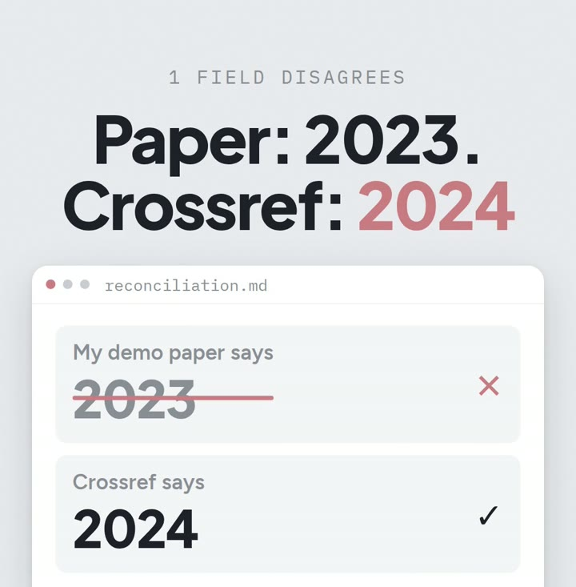

# R06: Catch the wrong year in your references

**Video:** 2026-11-06 · English voice

One wrong year in a reference list is easy to miss, and reviewers love finding it. This note
is the three steps from the video, plus the exact prompt, tested.

## The three steps

1. **Export your references as a BibTeX file** (`references.bib`), with each paper's DOI, its
   permanent ID. Zotero, Mendeley and most reference managers can export one.
2. **Ask your AI for a script** that checks every DOI against Crossref, the free publication
   database. The prompt is below.
3. **Run it before you submit.** It writes a table of every field where your entry and the
   record disagree.

## Measured

My demo paper's `references.bib` cites a survey with year **2023**. Its Crossref record says
**2024**. I planted that one: the survey was an arXiv preprint in 2023 and a journal article in
2024. The script found it in 1.3 s, and listed the one DOI that Crossref does not know (an
arXiv DOI, see Gotchas).



## Cost (prices as of Oct 2026)

- Crossref API: free, no sign-up, no key. It allows 5 requests a second, one at a time, or 10 a
  second and 3 at a time when your requests carry an email address (Crossref's documentation
  and response headers, checked 2026-10-20). A reference list of a few hundred entries runs
  well inside that.
- The script runs on your computer, standard Python only: $0.
- Any AI that writes code can write it from the prompt. I used Claude Code (Claude Max,
  $200/month, which I already pay for everything I build).

## Try it

Paste this into your AI (Claude, ChatGPT, Codex, Claude Code), in the folder that holds your
`references.bib`. Needs Python 3 and internet; no API key.

Tested 2026-10-29 with Claude Code on the demo `references.bib`. The first version stopped
with a 404 on an arXiv DOI, so the prompt now says what to do with those. Second run: 1
mismatch (year 2023 vs 2024), 1 DOI not in Crossref, 1.3 s.

```text
Write a Python script, check_bib.py, that reads my file references.bib. Use only the Python standard library.

For every entry with a doi field, fetch its record from https://api.crossref.org/works/ followed by the DOI (send a User-Agent header that includes mailto: and my email), and compare title, year, journal, volume and pages with my entry. Ignore differences in capitalization and punctuation. For the year, use the record's print date, then its online date.

Write a table to mismatches.md with: citation key, field, my value, Crossref value. Below the table, list the entries without a DOI, and the DOIs Crossref doesn't know (it answers 404; arXiv DOIs are registered at DataCite, not Crossref) instead of stopping.

Do not change references.bib. Print one line: how many mismatches, how many without DOI, how many not in Crossref.
```

Done when: `python3 check_bib.py` prints that line, `mismatches.md` has one row per field that
disagrees, and `references.bib` is unchanged.

## Gotchas

- **Not every DOI is a Crossref DOI.** arXiv DOIs (`10.48550/...`) are DataCite's, so Crossref's
  API returns a 404 for them. (Seen in the test.) If you need those too, ask the script to try
  `https://doi.org/<doi>` with `Accept: application/vnd.citationstyles.csl+json`.
- **The paper's year and the record's year can both be right.** A preprint year and a journal
  year differ. Decide which version you cite, then make the entry say so.
- **Titles differ in small ways all the time.** Sentence case, a dash, a subtitle. That is why the
  prompt ignores capitalization and punctuation; read the title rows before changing anything.
- **How my own bibliography is built:** it is generated from my notes (each paper's page name is
  its citation key), so I fix the note and rebuild instead of editing the `.bib`. That build is
  a story for another note.

---

**En español:** un año mal puesto en las referencias es fácil de pasar por alto. Tres pasos:
exporta tu bibliografía como `.bib` con el DOI de cada paper, pídele a tu IA un script que
compare cada DOI con Crossref (la base de datos gratis de publicaciones), y córrelo antes de
enviar. En mi paper de demo, el año decía 2023 y Crossref dice 2024: lo planté yo. El prompt de
arriba (en inglés) está probado el 2026-10-29. Costo: $0 (Crossref gratis, sin cuenta; precios
a oct 2026).
