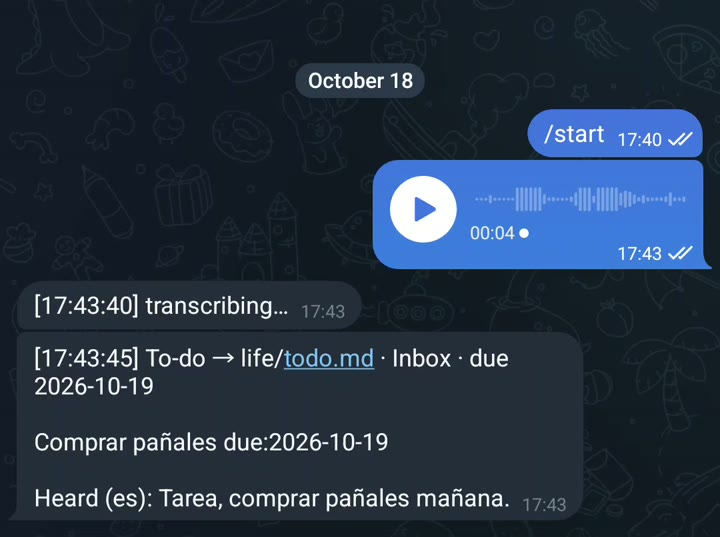

# R07: Mi lista de pendientes se llena sola

**Video:** 2026-11-09 · voz en inglés

¿Manos ocupadas y te acabas de acordar de algo? Díselo una vez a un bot de Telegram, y cae en
tu lista de pendientes con su fecha. Esta nota tiene los tres pasos del video, más el prompt.

## Los tres pasos

1. **Crea un bot de Telegram con BotFather.** En Telegram, escríbele a `@BotFather`, manda
   `/newbot` y elige un nombre. Te da un token: guárdalo en secreto, es la contraseña del bot.
2. **Instala Whisper en tu computadora:** `pip install faster-whisper`. Convierte la voz en
   texto en tu propia máquina, así tus notas de voz nunca van a un servicio de transcripción.
3. **Pídele a tu IA el script** con el prompt de abajo. Las notas de voz que empiezan con
   "tarea" (o "task") se vuelven una línea como `- [ ] Buy diapers due:2026-10-30` bajo
   `## Inbox` en tu `todo.md`.

## Medido

Mi propio bot, en vivo desde el celular, el 2026-10-18: unos **5 s** desde "transcribing" hasta
la tarea guardada (9 s para la primera nota, mientras carga el modelo). La nota "Tarea, comprar
pañales mañana" se volvió `- [ ] Comprar pañales due:2026-10-19`, el día siguiente.



## Costo (precios a oct 2026)

**$0.** Los bots de Telegram son gratis (más o menos 1 mensaje por segundo por chat, archivos
del bot de hasta 50 MB; preguntas frecuentes de bots de Telegram, revisadas el 2026-10-21).
Whisper corre en tu computadora. Obsidian, si lees `todo.md` ahí: gratis para uso personal.
Cualquier IA que escriba código puede escribir el script; yo uso Claude Code (Claude Max,
$200/mes, que ya pago para todo lo que construyo).

## Pruébalo

Pega esto en tu IA (Claude, ChatGPT, Codex, Claude Code) en una carpeta vacía. Necesitas
Python 3, ffmpeg, y el token y el chat id de tu bot.

Probado el 2026-10-29 con Claude Code: corrí la parte de voz a línea con dos notas grabadas,
sin Telegram. "Task, buy diapers tomorrow" y "Tarea, comprar pañales el viernes" cayeron las
dos bajo Inbox con la fecha correcta (viernes, 2026-10-30), en unos 9 s en el CPU. La parte de
Telegram necesita tu propio token, así que esa te toca probarla a ti.

El prompt va en inglés, que es como lo probé.

```text
Write a Python Telegram bot, voice_todo.py, using python-telegram-bot and faster-whisper. It only answers my chat id.

When I send a voice note: download it, transcribe it with faster-whisper on this computer (decode the audio with ffmpeg), then delete the audio file.

If the text starts with task, to do, tarea or pendiente, turn the rest into one line "- [ ] the task due:YYYY-MM-DD" and add it under "## Inbox" in todo.md (create the file if it is missing). Understand today, tomorrow and weekday names in English and Spanish; if there is no date, leave out due:. Reply with what you heard and the line you added.

Read the bot token and my chat id from the environment variables TELEGRAM_TOKEN and MY_CHAT_ID, never from the code. Put the voice-to-line part in its own function, and add a --file option so I can test it on an audio file without Telegram.
```

Listo cuando: `python3 voice_todo.py --file note.ogg` imprime lo que escuchó y agrega la línea a
`todo.md`; después, con las dos variables configuradas, una nota de voz a tu bot recibe la misma
respuesta.

## Ojo con esto

- **Las palabras cortas en inglés se pierden.** El modelo small de Whisper escuchó "Task, buy
  diapers tomorrow" como "Task by diapers tomorrow" (visto en la prueba), y mi propio bot una vez
  escuchó "Task: buy coffee tomorrow" como "Task by coffee tomorrow". Un modelo más grande
  (`large-v3-turbo`, el que usa mi bot) lo hace mejor, pero más lento. El español salió exacto
  las dos veces.
- **La primera nota después de reiniciar es más lenta** mientras carga el modelo.
- **Nunca pegues el token del bot en el código ni en un chat.** Quien lo tenga controla el bot.
  Las variables de entorno lo mantienen fuera del archivo.
- **Revisa el chat id.** Sin esa revisión, cualquiera que encuentre tu bot puede escribir en tu
  lista.

---

**In English:** I send a voice note to a Telegram bot; if it starts with "task", it becomes a
dated line in my `todo.md` under Inbox. Three steps: a free bot from BotFather, Whisper running
on your computer, and the script from the prompt above (tested 2026-10-29). Cost: $0 (prices as
of Oct 2026).
