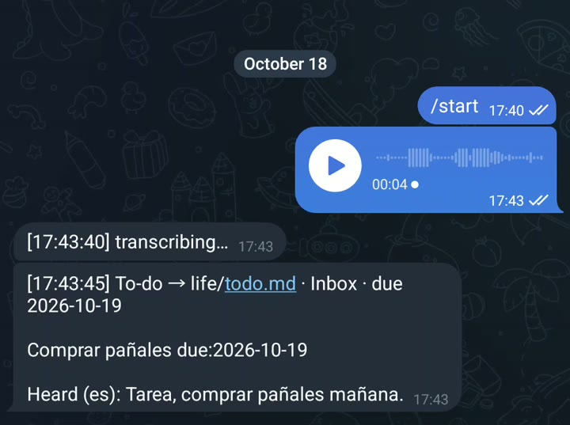

# R07: My to-do list fills itself

**Video:** 2026-11-09 · English voice

Hands full, and you just remembered a task? Say it once to a Telegram bot, and it lands in
your to-do list with its date. This note is the three steps from the video, plus the prompt.

## The three steps

1. **Make a Telegram bot with BotFather.** In Telegram, message `@BotFather`, send `/newbot`,
   pick a name. It gives you a token: keep it secret, it is the bot's password.
2. **Install Whisper on your computer:** `pip install faster-whisper`. It turns speech into
   text locally, so your voice notes never go to a transcription service.
3. **Ask your AI for the script** with the prompt below. Voice notes that start with "task"
   (or "tarea") become a line like `- [ ] Buy diapers due:2026-10-30` under `## Inbox` in your
   `todo.md`.

## Measured

My own bot, live from the phone, 2026-10-18: about **5 s** from "transcribing" to the filed
task (9 s for the first note, while the model loads). The note "Tarea, comprar pañales mañana"
became `- [ ] Comprar pañales due:2026-10-19`, the day after.



## Cost (prices as of Oct 2026)

**$0.** Telegram bots are free (about 1 message a second per chat, bot files up to 50 MB;
Telegram's bot FAQ, checked 2026-10-21). Whisper runs on your computer. Obsidian, if you read
`todo.md` there: free for personal use. Any AI that writes code can write the script; I use
Claude Code (Claude Max, $200/month, which I already pay for everything I build).

## Try it

Paste this into your AI (Claude, ChatGPT, Codex, Claude Code) in an empty folder. Needs
Python 3, ffmpeg, and your bot token and chat id.

Tested 2026-10-29 with Claude Code: I ran the voice-to-line part on two recorded notes,
without Telegram. "Task, buy diapers tomorrow" and "Tarea, comprar pañales el viernes" both
landed under Inbox with the right date (Friday, 2026-10-30), in about 9 s on the CPU. The
Telegram part needs your own token, so test that one yourself.

```text
Write a Python Telegram bot, voice_todo.py, using python-telegram-bot and faster-whisper. It only answers my chat id.

When I send a voice note: download it, transcribe it with faster-whisper on this computer (decode the audio with ffmpeg), then delete the audio file.

If the text starts with task, to do, tarea or pendiente, turn the rest into one line "- [ ] the task due:YYYY-MM-DD" and add it under "## Inbox" in todo.md (create the file if it is missing). Understand today, tomorrow and weekday names in English and Spanish; if there is no date, leave out due:. Reply with what you heard and the line you added.

Read the bot token and my chat id from the environment variables TELEGRAM_TOKEN and MY_CHAT_ID, never from the code. Put the voice-to-line part in its own function, and add a --file option so I can test it on an audio file without Telegram.
```

Done when: `python3 voice_todo.py --file note.ogg` prints what it heard and adds the line to
`todo.md`; then, with the two variables set, a voice note to your bot gets the same reply.

## Gotchas

- **Small English words get lost.** The small Whisper model heard "Task, buy diapers tomorrow"
  as "Task by diapers tomorrow" (seen in the test), and my own bot once heard "Task: buy coffee
  tomorrow" as "Task by coffee tomorrow". A bigger model (`large-v3-turbo`, what my bot uses)
  does better, slower. Spanish came out exact both times.
- **The first note after a restart is slower** while the model loads.
- **Never paste the bot token into the code or a chat.** Anyone with it controls the bot.
  Environment variables keep it out of the file.
- **Check the chat id.** Without that check, anyone who finds your bot can write to your list.

---

**En español:** le mando una nota de voz a un bot de Telegram; si empieza con "tarea", se
vuelve una línea con fecha en mi lista (`todo.md`, bajo Inbox). Tres pasos: crea un bot gratis
con BotFather, instala Whisper (`faster-whisper`, corre en tu computadora) y pídele a tu IA el
script con el prompt de arriba (en inglés). Probado el 2026-10-29 con dos notas grabadas.
Costo: $0 (precios a oct 2026).
