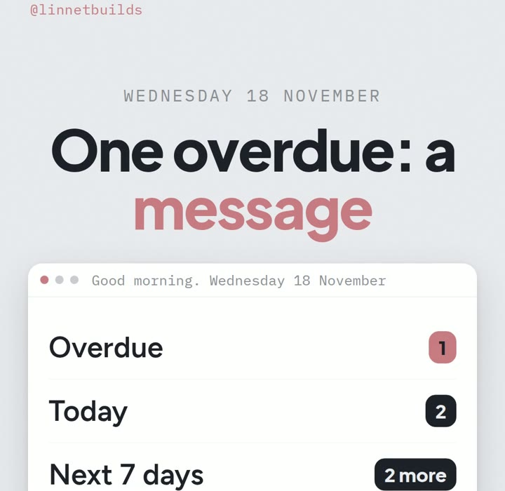

# R11: Mi teléfono solo habla si importa

**Video:** 2026-11-18 · voz en inglés

Tu teléfono te avisa de todo, menos de lo que vence hoy. Este script manda un solo mensaje
de Telegram en la mañana con lo atrasado y lo que vence hoy, y nada de nada cuando no hay
nada. Ni siquiera un buenos días.

## Los tres pasos

1. **Tus tareas en un archivo de texto**, una por línea, cada una con su fecha:
   `- [ ] Renew the parking permit due:2026-11-17`.
2. **Un bot gratis de Telegram y un script.** El bot lo creas con `@BotFather`; el script te
   lo escribe tu IA con el prompt de abajo.
3. **Prográmalo cada mañana.** Linux o Mac: `crontab -e` y una línea como
   `0 7 * * * cd /path/to/folder && python3 digest.py --send`. Windows: el Programador de
   tareas (Task Scheduler).

## Medido

Con la lista de demo, para el miércoles 18 de noviembre: 1 atrasada, 2 para hoy, un solo
mensaje. Para el lunes 16 de noviembre, cuando no vencía nada: nada en pantalla, ningún
mensaje.



## Costo (precios a oct 2026)

**$0.** El script no usa IA cuando corre. Los bots de Telegram son gratis (más o menos 1
mensaje por segundo por chat, archivos del bot de hasta 50 MB; según el FAQ de bots de
Telegram, revisado el 2026-10-21). Cualquier IA que escriba código puede hacerlo con el
prompt; yo uso Claude Code (Claude Max, $200/mes, que ya pago para todo lo que construyo).

## Pruébalo

Pega esto en tu IA (Claude, ChatGPT, Codex, Claude Code), en la carpeta donde está tu
`todo.md`. Necesitas Python 3, el token de tu bot y tu chat id.

Probado el 2026-10-29 con Claude Code en un `todo.md` de cinco líneas: para 2026-11-18 mostró
1 atrasada y 2 para hoy; para 2026-11-16 no mostró nada y terminó sin errores. El envío en sí
necesita tu propio bot, así que esa parte pruébala tú con `--send`.

El prompt va en inglés, que es como lo probé.

```text
Write a Python script, digest.py, standard library only. It reads todo.md, where each open task is a line like "- [ ] the task due:YYYY-MM-DD". Ignore done tasks ("- [x]").

If any open task is overdue or due today, build one message: "Good morning. <weekday day month>", then "Overdue (n)" with each task and the date it was due, then "Today (n)" with each task. If there are none, print and send nothing at all.

By default only print the message. With --send, send it through the Telegram Bot API (sendMessage). Read the bot token and my chat id from config.json, never from the code, and never print them. Add --date YYYY-MM-DD so I can test any day.
```

## Ojo con esto

- **"Nada" tiene que ser nada.** Pídelo explícitamente: muchas primeras versiones mandan
  "Good morning, no tasks today", que es justo el mensaje que no querías.
- **cron corre en otra carpeta.** Pon `cd /path/to/folder &&` antes del comando, o usa rutas
  absolutas, o el script no va a encontrar `todo.md`.
- **El token, fuera del script.** `config.json` no va en ningún repositorio ni en ninguna
  grabación de pantalla.
- **Si tu computadora está apagada a las 7, no hay mensaje.** cron no se pone al día; el
  Programador de tareas sí puede ("run as soon as possible after a missed start").

---

**In English:** a Telegram digest that only writes when something is overdue or due today,
and sends nothing when there's nothing. Tested 2026-10-29. Cost: $0 (prices as of Oct 2026).
