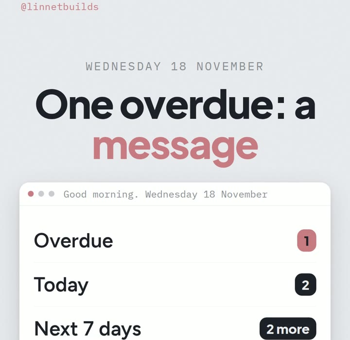

# R11: My phone only talks if it matters

**Video:** 2026-11-18 · English voice

Your phone pings you about everything, except what's due today. This script sends one
Telegram message in the morning with what's overdue and what's due today, and nothing at all
when there's nothing. Not even good morning.

## The three steps

1. **Your tasks in a text file**, one per line, each with its date:
   `- [ ] Renew the parking permit due:2026-11-17`.
2. **A free Telegram bot and one script.** Make the bot with `@BotFather`; your AI writes the
   script with the prompt below.
3. **Schedule it every morning.** Linux or Mac: `crontab -e` and a line like
   `0 7 * * * cd /path/to/folder && python3 digest.py --send`. Windows: Task Scheduler.

## Measured

On the demo list, for Wednesday 18 November: 1 overdue, 2 due today, one message. For
Monday 16 November, when nothing was due: no output, no message.



## Cost (prices as of Oct 2026)

**$0.** The script uses no AI when it runs. Telegram bots are free (about 1 message a second
per chat, bot files up to 50 MB; Telegram's bot FAQ, checked 2026-10-21). Any AI that writes
code can write it from the prompt; I use Claude Code (Claude Max, $200/month, which I already
pay for everything I build).

## Try it

Paste this into your AI (Claude, ChatGPT, Codex, Claude Code), in the folder with your
`todo.md`. Needs Python 3 and your bot token and chat id.

Tested 2026-10-29 with Claude Code on a five-line `todo.md`: for 2026-11-18 it printed 1
overdue and 2 due today; for 2026-11-16 it printed nothing and exited cleanly. The send itself
needs your own bot, so test that part yourself with `--send`.

```text
Write a Python script, digest.py, standard library only. It reads todo.md, where each open task is a line like "- [ ] the task due:YYYY-MM-DD". Ignore done tasks ("- [x]").

If any open task is overdue or due today, build one message: "Good morning. <weekday day month>", then "Overdue (n)" with each task and the date it was due, then "Today (n)" with each task. If there are none, print and send nothing at all.

By default only print the message. With --send, send it through the Telegram Bot API (sendMessage). Read the bot token and my chat id from config.json, never from the code, and never print them. Add --date YYYY-MM-DD so I can test any day.
```

## Gotchas

- **"Nothing" must mean nothing.** Ask for it explicitly: many first versions send "Good
  morning, no tasks today", which is exactly the message you didn't want.
- **cron runs in another folder.** Use `cd /path/to/folder &&` before the command, or absolute
  paths, or the script won't find `todo.md`.
- **Keep the token out of the script.** `config.json` stays out of any repository or screen
  recording.
- **If your computer is off at 7, there is no message.** cron doesn't catch up; Task Scheduler
  can ("run as soon as possible after a missed start").

---

**En español:** un resumen por Telegram que solo te escribe si algo venció o vence hoy, y no
manda nada si no hay nada. Tres pasos: tareas con fecha en un archivo de texto, un bot gratis
y un script (el prompt de arriba, en inglés), y programarlo cada mañana. Probado el
2026-10-29. Costo: $0 (precios a oct 2026).
