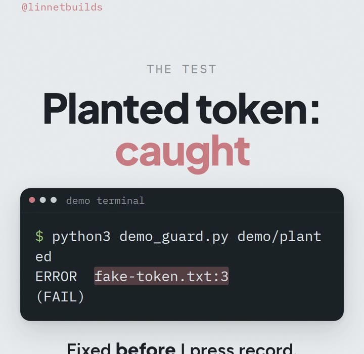

# R12: Mi revisión antes de grabar la pantalla

**Video:** 2026-11-20 · voz en inglés

Un solo cuadro de una grabación de pantalla puede filtrar una contraseña, un nombre o la ruta
de una carpeta. Esta es la revisión que hago antes de cada grabación, en tres pasos, con el
prompt para el escáner.

## Los tres pasos

1. **Una lista privada de lo que nunca debe salir:** nombres, rutas de carpetas, usuarios de
   cuentas, uno por línea en `never-show.txt`. Guárdala fuera de la carpeta que vas a grabar.
2. **Antes de grabar, un script revisa todo lo que vas a mostrar** buscando esa lista, y
   además cualquier cosa con forma de contraseña, API key o token de bot. Te dice el archivo y
   la línea, nunca el secreto completo, y termina con PASS o FAIL.
3. **Notificaciones apagadas, apps de chat y correo cerradas, una sola ventana.** Graba una
   ventana, nunca el escritorio entero.

## Medido

Para probarlo, escondí un token de bot falso en mi propia demo. El escáner lo atrapó: archivo
y línea, FAIL, antes de que yo apretara grabar. Con la demo limpia termina en PASS.



## Costo (precios a oct 2026)

**$0.** Un script de Python en tu computadora. Cualquier IA que escriba código puede hacerlo
con el prompt; yo uso Claude Code (Claude Max, $200/mes, que ya pago para todo lo que
construyo).

## Pruébalo

Pega esto en tu IA (Claude, ChatGPT, Codex, Claude Code). Necesitas Python 3.

Probado el 2026-10-29 con Claude Code en una carpeta de prueba con un token falso en un archivo
y una ruta privada en otro: reportó los dos con archivo y línea, mostró solo los primeros
caracteres, imprimió FAIL y salió con 1.

El prompt va en inglés, que es como lo probé.

```text
Write a Python script, scan.py, standard library only, that scans a folder before I record my screen.

It reads my private list from never-show.txt (one word or phrase per line, matched without caring about upper or lower case) and also flags anything shaped like a password, API key or bot token. For each hit, print the file, the line number and which rule matched, showing only the first 4 characters of what it found, never the full secret.

Skip files it cannot read as text. End with PASS if nothing was found and FAIL if anything was, and exit with 1 on FAIL. Usage: python3 scan.py <folder>.
```

## Ojo con esto

- **El escáner solo lee archivos.** No ve las pestañas del navegador, las notificaciones del
  escritorio ni el mensaje que aparece a mitad de la grabación. Para eso está el paso 3.
- **`never-show.txt` va fuera de la carpeta que grabas**, o la lista misma se vuelve la
  filtración. Sería irónico, pero no gracioso.
- **Las formas se pierden cosas.** Una contraseña sin un `password=` al lado parece cualquier
  otra palabra. Las que te preocupan, ponlas en la lista privada.
- **Revisa también el video terminado.** Después de editar, paso reconocimiento de texto (OCR)
  por el archivo final cada medio segundo, porque un cuadro puede mostrar algo que el escáner
  nunca vio.

---

**In English:** a private never-show list, a script that scans for it and for anything shaped
like a password or token, and one window with notifications off. It caught a planted fake
token. Tested 2026-10-29. Cost: $0 (prices as of Oct 2026).
