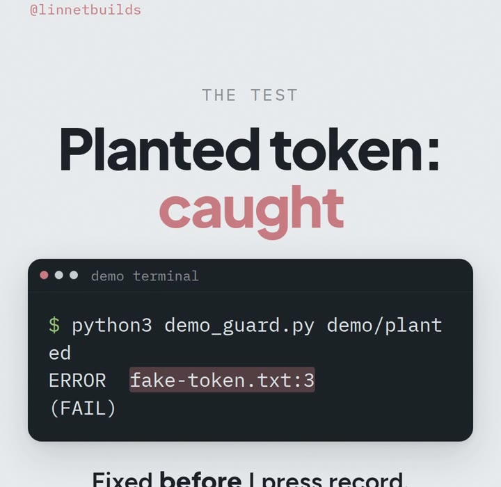

# R12: My check before I record my screen

**Video:** 2026-11-20 · English voice

One frame of a screen recording can leak a password, a name or a folder path. This is the
check I run before every recording, in three steps, with the prompt for the scanner.

## The three steps

1. **A private list of what must never appear:** names, folder paths, account handles, one
   per line in `never-show.txt`. Keep it outside the folder you record.
2. **Before recording, a script scans everything you'll show** for that list, plus anything
   shaped like a password, API key or bot token. It reports the file and line, never the full
   secret, and ends with PASS or FAIL.
3. **Notifications off, chat and mail apps closed, one window only.** Record a window, never
   the whole desktop.

## Measured

I planted a fake bot token in my own demo to test it. The scan caught it: file and line,
FAIL, before I pressed record. On the clean demo it ends in PASS.



## Cost (prices as of Oct 2026)

**$0.** A Python script on your computer. Any AI that writes code can write it from the
prompt; I use Claude Code (Claude Max, $200/month, which I already pay for everything I build).

## Try it

Paste this into your AI (Claude, ChatGPT, Codex, Claude Code). Needs Python 3.

Tested 2026-10-29 with Claude Code on a test folder with a fake token in one file and a private
path in another: it reported both with file and line, showed only the first characters, printed
FAIL and exited with 1.

```text
Write a Python script, scan.py, standard library only, that scans a folder before I record my screen.

It reads my private list from never-show.txt (one word or phrase per line, matched without caring about upper or lower case) and also flags anything shaped like a password, API key or bot token. For each hit, print the file, the line number and which rule matched, showing only the first 4 characters of what it found, never the full secret.

Skip files it cannot read as text. End with PASS if nothing was found and FAIL if anything was, and exit with 1 on FAIL. Usage: python3 scan.py <folder>.
```

## Gotchas

- **A scan only reads files.** It can't see your browser tabs, desktop notifications or a
  message that pops up mid-recording. That's what step 3 is for.
- **Keep `never-show.txt` out of the recorded folder**, or the list itself becomes the leak.
- **Shapes miss things.** A password with no `password=` next to it looks like any other word.
  Put the ones you worry about on the private list.
- **Check the finished video too.** After editing, I run text recognition (OCR) on the final
  file every half second, because a frame can show something the scan never saw.

---

**En español:** antes de grabar la pantalla: una lista privada de lo que nunca debe salir, un
script que busca esa lista y cualquier cosa con forma de contraseña o token (prompt de arriba,
en inglés), y una sola ventana con las notificaciones apagadas. Puse un token falso para
probarlo y lo atrapó: archivo, línea y FAIL. Probado el 2026-10-29. Costo: $0 (precios a oct
2026).
